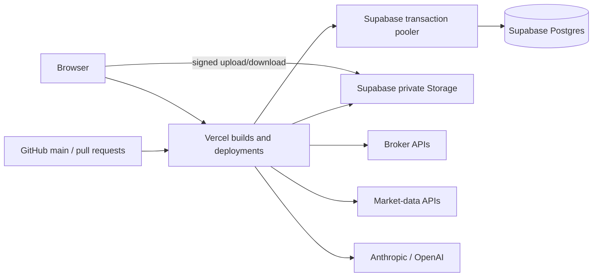

# Kế hoạch chuyển Trade Journal sang Supabase + Vercel

## 1. Mục tiêu và quyết định kiến trúc

Mục tiêu là chạy ứng dụng trên Vercel, tự động deploy từ GitHub, trong khi dữ liệu bền vững nằm trên Supabase và không phụ thuộc filesystem của Vercel.

Phạm vi đề xuất cho lần chuyển đầu tiên:

- Giữ mô hình **single-user** và cơ chế `JOURNAL_PASSWORD` hiện tại.
- Giữ `packages/core` và `packages/importers` độc lập, không đổi thuật toán nghiệp vụ.
- Chuyển SQLite sang **Supabase Postgres**, truy cập từ server bằng Drizzle + Postgres.js.
- Chuyển attachment và dữ liệu nến CSV lớn sang **Supabase Storage**.
- Chỉ server được dùng thông tin truy cập đặc quyền; trình duyệt chỉ nhận signed upload/download URL có thời hạn khi cần.
- Không đưa Supabase Auth, multi-user hoặc RLS theo người dùng vào đợt đầu.
- Tắt Supabase Data API nếu ứng dụng chỉ truy cập bằng Drizzle. Bucket Storage phải private.
- Không chạy migration trong lúc ứng dụng khởi động hoặc trong mỗi Vercel build.

### Biến môi trường mục tiêu

| Biến                                   | Nơi dùng               | Ghi chú                                                 |
| -------------------------------------- | ---------------------- | ------------------------------------------------------- |
| `DATABASE_URL`                         | Vercel runtime         | Supabase shared pooler, transaction mode                |
| `DIRECT_DATABASE_URL`                  | migration có kiểm soát | Direct connection; không đưa vào client bundle          |
| `SUPABASE_URL`                         | server                 | Storage API                                             |
| `SUPABASE_SERVICE_ROLE_KEY`            | server                 | Chỉ server; tuyệt đối không dùng tiền tố `NEXT_PUBLIC_` |
| `JOURNAL_SECRET`                       | server                 | Bắt buộc, cố định lâu dài để giải mã credentials        |
| `JOURNAL_PASSWORD`                     | server                 | Giữ auth single-user hiện tại                           |
| `ANTHROPIC_API_KEY` / `OPENAI_API_KEY` | server, tùy chọn       | Giữ cách hoạt động hiện tại                             |

Kết nối runtime phải được tạo một lần ở module scope với `max: 1`, `prepare: false` và SSL bắt buộc. Đây là cấu hình phù hợp với Supabase transaction pooler trong môi trường serverless.

## 2. Hiện trạng và phạm vi thay đổi

Ứng dụng hiện dùng `better-sqlite3` đồng bộ, bootstrap schema khi process khởi động và lưu database trên ổ đĩa. Có khoảng 228 lần gọi theo kiểu `.get()`, `.all()`, `.run()` hoặc transaction đồng bộ trong 43 file sử dụng DB dưới `apps/web/src`.

Các điểm trung tâm:

- `apps/web/src/db/schema.ts`: schema SQLite.
- `apps/web/src/db/index.ts`: mở `journal.db`, bật WAL/foreign keys và chạy bootstrap.
- `apps/web/src/db/bootstrap.ts`: DDL và additive upgrades.
- `apps/web/src/server/rebuild.ts`: materialize trades từ executions.
- `apps/web/src/server/executions.ts`: insert/dedup executions và rebuild.
- `apps/web/src/server/settings.ts`: settings và encrypted API keys.
- `apps/web/src/server/crypto.ts`: hiện có fallback tạo file `.secret`.
- `apps/web/src/server/market-data/csv.ts`: lưu toàn bộ candle arrays dưới dạng JSON trong SQLite và cache trong process.
- `apps/web/src/app/api/attachments/**`: lưu attachment BLOB trong SQLite.
- Hầu hết `apps/web/src/app/api/**/route.ts`: gọi DB đồng bộ.

`packages/core` và `packages/importers` không phụ thuộc database hoặc framework nên không cần đổi API công khai.

## 3. Kiến trúc đích

### Phân chia dữ liệu

**Postgres:**

- accounts, executions, materialized trades
- journal days, folders, notes, templates
- playbooks, rule checks, routines, missed trades
- settings và encrypted credentials
- prop-firm ledger và audit
- import provenance/batches
- attachment metadata
- market CSV metadata
- saved excursion estimates

**Supabase Storage:**

- attachment binaries
- normalized hoặc compressed market-candle datasets
- file import tạm thời khi payload vượt giới hạn Vercel
- file export lớn được tạo theo yêu cầu

## 4. Kế hoạch triển khai theo giai đoạn

### Giai đoạn 0 — Khóa baseline và đường lui

1. Chạy và ghi nhận baseline:
   - `pnpm run test`
   - `pnpm run typecheck`
   - `pnpm run build`
   - `pnpm run format:check`
2. Tạo fixture SQLite đại diện có:
   - nhiều account/currency
   - open/closed trades, partial fills, flip position
   - trade annotations và rule checks
   - notes/journal/playbooks/routines
   - attachments
   - market CSV + saved MAE/MFE
   - prop accounts/entries/receipts/audit
3. Ghi checksum/count và các aggregate quan trọng trước migration:
   - số row từng bảng
   - tổng quantity/fees/net P&L theo account
   - số open/closed trades
   - attachment byte count/hash
4. Chưa xóa SQLite support cho đến khi công cụ migrate và đối chiếu dữ liệu chạy thành công.

**Điều kiện hoàn thành:** baseline xanh và có fixture dùng được để chứng minh parity.

### Giai đoạn 1 — Tạo Postgres schema và migration workflow

1. Đổi schema từ `drizzle-orm/sqlite-core` sang `drizzle-orm/pg-core`.
2. Giữ tên bảng/cột hiện tại để giảm phạm vi thay đổi.
3. Mapping kiểu dữ liệu ban đầu:
   - text timestamps tiếp tục là `text` để không thay đổi timezone semantics trong cùng migration.
   - SQLite `REAL` chuyển sang Postgres `double precision` để giữ hành vi tính toán hiện tại.
   - integer boolean chuyển sang `boolean`.
   - các khoản tiền prop-firm đang dùng minor units tiếp tục dùng integer/bigint phù hợp.
   - JSON text tiếp tục là text trong đợt đầu, trừ nơi cần Postgres JSON operator rõ ràng.
4. Bỏ `attachments.data`; thêm `storage_path`, trạng thái upload nếu cần và unique constraint cho object path.
5. Bỏ `market_csv_datasets.bars_json`; thêm `storage_path`, format/version/checksum cùng metadata bounds hiện có.
6. Thêm `drizzle.config.ts`, generated SQL migrations và scripts:
   - `db:generate`
   - `db:migrate`
   - `db:check`
7. Seed system folders bằng migration idempotent thay vì bootstrap lúc khởi động.
8. Bỏ `BOOTSTRAP_SQL` và toàn bộ `ALTER TABLE` lúc runtime sau khi Postgres path đã ổn định.

**Điều kiện hoàn thành:** database trống có thể được dựng hoàn toàn từ migrations và schema Drizzle khớp database.

### Giai đoạn 2 — Thay database client và async hóa lớp truy cập dữ liệu

1. Thay `better-sqlite3` bằng `postgres` + `drizzle-orm/postgres-js`.
2. Tạo client module-scope:
   - pool tối đa 1 connection trên mỗi warm Vercel instance
   - `prepare: false`
   - SSL bắt buộc
3. Đổi helper DB sang async trước:
   - settings
   - trades query
   - execution listing
   - IDs/hash helpers không đổi
4. Đổi toàn bộ `.get()`, `.all()`, `.run()` và caller sang `await`.
5. Không tạo generic repository lớn. Giữ query cạnh domain hiện tại để diff dễ review.
6. Đổi route handlers sang async một cách nhất quán; không để promise chưa await trong response.
7. Cấu hình Vercel và Supabase cùng khu vực gần người dùng/nhau nhất có thể để giảm độ trễ.

**Điều kiện hoàn thành:** mọi API route compile với Postgres client; không còn import `better-sqlite3` trong production code.

### Giai đoạn 3 — Làm lại transaction và concurrency correctness

Đây là giai đoạn rủi ro cao nhất.

1. `rebuildAccount` nhận transaction/client rõ ràng thay vì luôn dùng global `db`.
2. `insertExecutions`, dedup, rebuild trades và manual notes phải chạy trong cùng transaction.
3. Broker sync phải commit đồng thời:
   - inserted executions
   - rebuilt trades
   - rotated credentials
   - account snapshot/last sync
4. NinjaTrader reconciliation, account transfer, account clear, multiplier rebuild và IBKR timezone recovery phải dùng cùng transaction client.
5. Thay SQLite `behavior: "immediate"` bằng chiến lược Postgres:
   - row lock trên account (`FOR UPDATE`) cho các mutation/rebuild của một account
   - unique constraints cho dedup
   - retry có giới hạn cho serialization/deadlock nếu thật sự cần
6. Prop-firm revision checks và audit insert phải ở cùng transaction để tránh lost update.
7. Kiểm tra callback xoay broker credentials: nếu SDK callback không await promise, buffer credentials mới và persist trước khi transaction sync hoàn tất.
8. Đổi SQLite JSON expression `json_extract(...)` sang Postgres JSON operator hoặc lưu `dataset_id` thành cột riêng để xóa estimate theo dataset an toàn.

**Điều kiện hoàn thành:** hai request import/sync đồng thời không tạo duplicate, mất annotation hoặc tạo trades sai; transaction failure không để lại dữ liệu nửa chừng.

### Giai đoạn 4 — Chuyển attachments sang Supabase Storage

1. Tạo private bucket, ví dụ `journal-attachments`.
2. Giữ API metadata hiện tại để UI ít đổi.
3. Không proxy file 8 MB xuyên qua Vercel Function vì request/response body của Vercel Function bị giới hạn 4.5 MB.
4. Dùng flow upload trực tiếp:
   - server xác thực owner và cấp signed upload URL/path
   - browser upload trực tiếp vào Storage
   - server finalize, kiểm tra object metadata/MIME/size rồi đánh dấu metadata hoàn tất
5. Download qua signed URL ngắn hạn hoặc route authenticated trả redirect, không public bucket.
6. Delete phải xóa cả object và metadata; xử lý retry/idempotency khi một bước thất bại.
7. Thêm cơ chế dọn object/metadata pending bị bỏ dở.

**Điều kiện hoàn thành:** upload/download/delete PNG, JPEG, WebP và PDF tới giới hạn 8 MB vẫn hoạt động mà không đi qua payload lớn của Vercel.

### Giai đoạn 5 — Xử lý các payload lớn và Storage-backed market data

Ba luồng hiện có nguy cơ vượt giới hạn 4.5 MB của Vercel:

1. **AI PDF import:** hiện PDF 8 MB được base64 và gửi trong JSON, chắc chắn có thể vượt giới hạn.
2. **Market candle CSV:** endpoint nhận JSON chứa CSV tới 5 MB.
3. **Full export hoặc replay response:** có thể vượt giới hạn khi lịch sử/candle count lớn.

Cách xử lý:

- Upload file import/PDF/market CSV trực tiếp vào private Storage bằng signed URL.
- API preview/commit chỉ nhận object path, checksum và options nhỏ.
- Server tải object, xác minh checksum/size/type rồi parse.
- Xóa temporary import object sau commit/cancel hoặc theo cleanup policy.
- Market CSV sau parse được lưu dưới dạng normalized compressed object; Postgres chỉ giữ metadata và checksum.
- Cache decoded bars trong process chỉ là optimization; correctness không phụ thuộc cache vì Vercel có nhiều instance và instance có thể biến mất.
- Đo kích thước response của 20.000 bars. Nếu có thể vượt 4.5 MB, phân trang/chunk replay data hoặc tạo object tạm và trả signed URL.
- Full JSON export lớn được tạo vào Storage và trả signed download URL, thay vì trả toàn bộ qua một function response.

**Điều kiện hoàn thành:** các file ở đúng giới hạn tính năng hiện tại vẫn preview/import/export được trên Vercel Hobby.

### Giai đoạn 6 — Công cụ chuyển dữ liệu SQLite sang Supabase

Tạo CLI chạy cục bộ, không phải API public:

1. Mở `journal.db` read-only.
2. Kiểm tra schema/version nguồn.
3. Migrate theo thứ tự foreign key, dùng batch có giới hạn.
4. Giữ nguyên IDs, stable trade keys, timestamps, hashes và encrypted credential envelopes.
5. Upload attachment BLOB sang Storage, lưu checksum/path vào Postgres.
6. Chuyển candle JSON sang Storage, giữ metadata bounds và checksum.
7. Không tự ý đổi hoặc trim `JOURNAL_SECRET`; secret trên Vercel phải giống chính xác secret đã mã hóa dữ liệu nguồn. Nếu bản SQLite dùng file `.secret` ngẫu nhiên thay vì `JOURNAL_SECRET`, migration CLI phải có bước chuyển khóa được người vận hành cấp quyền rõ ràng: giải mã bằng khóa nguồn và mã hóa lại bằng `JOURNAL_SECRET` đích. Không thể coi chuỗi hex trong `.secret` là passphrase tương đương, vì đường nguồn dùng khóa thô còn đường env dùng scrypt. Không đọc khóa nguồn hoặc credentials thật trong lúc phát triển/test.
8. Sau migrate, đối chiếu:
   - row counts
   - aggregate executions/trades/P&L
   - annotations
   - attachment hashes
   - market dataset bar counts/ranges
   - prop audit counts
9. Hỗ trợ dry-run và không ghi đè database đích không rỗng nếu thiếu flag xác nhận rõ ràng.
10. Xuất migration report nhưng không in credentials hoặc secrets.

**Điều kiện hoàn thành:** fixture baseline chuyển sang Postgres đạt toàn bộ parity checks; chạy lại không nhân đôi dữ liệu.

### Giai đoạn 7 — Test strategy mới

1. Unit tests của `packages/core` và `packages/importers` giữ nguyên.
2. Thay test SQLite tạm bằng Postgres test database:
   - local Supabase CLI/Docker cho developer
   - Postgres service container trong GitHub Actions
3. Mỗi test file/suite dùng schema riêng, transaction rollback hoặc deterministic cleanup.
4. Tách test migration SQLite → Postgres khỏi test app runtime.
5. Thêm integration tests cho:
   - Postgres migrations
   - transaction rollback
   - concurrent import/dedup/rebuild
   - annotation survival
   - prop revision conflict
   - signed attachment upload/finalize/delete
   - Storage failure compensation
   - payload lớn
   - broker credential rotation
6. Thêm smoke test deployment dùng preview environment nhưng không dùng production database.

**Điều kiện hoàn thành:** `format:check`, `typecheck`, tests và production build đều xanh trên GitHub Actions.

### Giai đoạn 8 — Vercel/GitHub deployment

1. Import repository root vào Vercel để workspace packages vẫn được thấy.
2. Dùng Node 22 và pnpm version đã pin trong root `package.json`.
3. Build command: `pnpm build`.
4. Xóa cấu hình dành riêng cho SQLite khỏi `next.config.ts`:
   - `serverExternalPackages: ["better-sqlite3"]`
   - local data tracing exclusions không còn cần thiết
5. `output: "standalone"` chỉ giữ nếu Docker path còn được hỗ trợ; Vercel không cần cấu hình này.
6. Production và Preview không được mặc định dùng chung database ghi dữ liệu:
   - production dùng production project
   - preview dùng project/schema riêng hoặc preview ở read-only/sandbox mode
7. Migration chạy như release step có kiểm soát, không chạy song song trong mọi preview build.
8. Vercel Function region phải được đặt gần Supabase project.
9. Health/smoke checks sau deploy:
   - login
   - account list
   - dashboard stats
   - create manual trade
   - import preview/commit
   - attachment round trip
   - export

**Điều kiện hoàn thành:** push/PR tạo deployment đúng môi trường; production deploy không chạy migration lặp hoặc ghi vào preview database.

### Giai đoạn 9 — Cutover và rollback

1. Đóng mutation trên bản SQLite trong thời gian cutover.
2. Backup toàn bộ data directory và giữ bản bất biến.
3. Chạy migrate CLI, xem parity report.
4. Deploy production Vercel với đúng `JOURNAL_SECRET`.
5. Chạy smoke tests và đối chiếu dashboard totals với bản cũ.
6. Chỉ mở mutation sau khi parity đạt.
7. Rollback nếu lỗi:
   - trỏ domain về hệ thống cũ
   - không merge ngược dữ liệu đã ghi ở cả hai bên
   - nếu production mới đã nhận writes, export/diff chúng trước khi quay lại
8. Giữ SQLite backup ít nhất qua vài chu kỳ sử dụng và một lần export/restore verification.

## 5. Báo cáo ảnh hưởng tính năng

| Tính năng                              | Mức ảnh hưởng                        | Dự kiến sau migration          | Rủi ro/việc cần làm                                                                             |
| -------------------------------------- | ------------------------------------ | ------------------------------ | ----------------------------------------------------------------------------------------------- |
| Dashboard, metrics, Edge Score, charts | Trung bình                           | Giữ nguyên                     | Query chuyển async và có network latency; cần đo response `/api/stats`                          |
| Round-trip FIFO/LIFO/WAVG              | Cao ở integration, thấp ở thuật toán | Giữ nguyên kết quả             | `packages/core` không đổi; transaction rebuild phải được làm lại đúng                           |
| Manual trade entry                     | Cao                                  | Giữ nguyên                     | Insert + rebuild + notes phải atomic                                                            |
| CSV/HTML statement import              | Cao                                  | Giữ nguyên                     | File lớn cần upload thẳng Storage; dedup/concurrency phải test lại                              |
| AI PDF statement import                | Cao                                  | Giữ nguyên nếu đổi upload flow | Cách base64 8 MB hiện tại không chạy qua giới hạn 4.5 MB của Vercel                             |
| NinjaTrader reconciliation             | Rất cao                              | Giữ nguyên                     | Nhiều transaction và provenance records; cần parity/concurrency tests riêng                     |
| Broker sync                            | Rất cao                              | Giữ manual sync                | Outbound call và DB commit trong function; credential rotation và timeout là điểm rủi ro        |
| Auto-sync                              | Không phát sinh regression hiện tại  | Vẫn như hiện tại               | Schema có `autoSync`, nhưng code hiện chưa có scheduler nền; không nên tuyên bố có sync định kỳ |
| Accounts/archive/clear/transfer        | Cao                                  | Giữ nguyên                     | Transfer đổi stable key và copy annotations; phải transaction + lock đúng                       |
| Multi-currency conversion              | Trung bình                           | Giữ nguyên                     | Settings chuyển async; đối chiếu dashboard/calendar totals                                      |
| Journal days và voice dictation        | Thấp–trung bình                      | Giữ nguyên                     | Voice chạy phía browser; save/autosave chuyển sang network Postgres                             |
| Notebook/folders/notes                 | Trung bình                           | Giữ nguyên                     | Folder soft-delete và note preservation cần regression tests                                    |
| Playbooks/rule adherence               | Trung bình                           | Giữ nguyên                     | Foreign keys và transactional updates cần xác nhận                                              |
| Routines/progress/missed trades        | Trung bình                           | Giữ nguyên                     | CRUD async, không thay đổi UI                                                                   |
| Prop firm tracker                      | Rất cao                              | Giữ nguyên                     | Revision checks, audit trail và cash ledger phải ở cùng transaction                             |
| Attachments                            | Rất cao, UI flow thay đổi bên trong  | Giữ loại file và giới hạn 8 MB | Chuyển BLOB sang private Storage, upload trực tiếp bằng signed URL                              |
| Market provider replay                 | Cao                                  | Giữ nguyên                     | Function timeout, response 4.5 MB và provider pagination cần đo/test                            |
| Market candle CSV                      | Rất cao                              | Giữ nguyên                     | Không gửi JSON 5 MB qua function; bars chuyển sang Storage-backed object                        |
| MAE/MFE estimates                      | Cao                                  | Giữ nguyên                     | Fingerprints và invalidation khi dataset bị xóa phải giữ đúng                                   |
| AI recap/critique/ask journal          | Trung bình–cao                       | Giữ nguyên                     | Async query scope; function tối đa 300 giây trên Vercel Hobby                                   |
| Settings/API credentials               | Cao                                  | Giữ nguyên                     | `JOURNAL_SECRET` bắt buộc; mất secret đồng nghĩa không giải mã được credentials                 |
| Password login                         | Thấp                                 | Giữ nguyên single-user auth    | Cookie/HMAC tiếp tục ở server; API vẫn phải xác minh cryptographically                          |
| Privacy mode                           | Thấp                                 | Không ảnh hưởng                | Chủ yếu client-side                                                                             |
| Demo data                              | Cao ở DB path                        | Giữ nguyên                     | Bulk insert/rebuild cần async transaction và kiểm tra timeout                                   |
| Full JSON export                       | Cao                                  | Giữ nội dung hiện tại          | Export lớn cần Storage-generated download thay vì response >4.5 MB                              |
| Trade CSV/review PDF/PNG export        | Thấp–trung bình                      | Giữ nguyên                     | Kiểm tra kích thước response và font/assets trong function bundle                               |
| Local/offline self-hosting bằng SQLite | **Bị mất nếu chuyển hẳn**            | Không còn mặc định             | Muốn giữ phải duy trì dual adapter, làm phạm vi và test gần gấp đôi                             |
| Docker deployment hiện tại             | Cao                                  | Cần đổi hoặc đánh dấu legacy   | Dockerfile đang giả định `/data/journal.db`                                                     |
| Local development                      | Cao                                  | Cần Postgres/Supabase local    | Không còn chỉ chạy `pnpm dev` với SQLite trống                                                  |
| Backups                                | Cao                                  | Chuyển cách vận hành           | Cần DB backup + Storage objects; copy thư mục `data/` không còn đủ                              |

## 6. Những thay đổi hành vi người dùng sẽ thấy

Dự kiến giữ nguyên giao diện và nghiệp vụ. Các thay đổi có thể nhìn thấy:

1. Upload attachment, AI PDF và market CSV sẽ có bước upload trực tiếp lên Storage; progress/error có thể khác.
2. Request đầu tiên sau thời gian không dùng có thể chậm hơn do Vercel cold start hoặc Supabase Free bị pause.
3. Một số thao tác bulk/import/rebuild có thể cần progress UI hoặc job-style status nếu không ổn định trong giới hạn function.
4. Không còn khả năng chạy hoàn toàn offline với database cục bộ nếu bỏ SQLite path.
5. Backup không còn là sao chép một thư mục; phải backup cả Postgres và Storage.

## 7. Giới hạn của free tier cần chấp nhận

- Vercel Hobby giới hạn request và response body của Function ở 4.5 MB và function Node.js tối đa 300 giây.
- Supabase Free hiện có 500 MB database, 1 GB file storage và có thể pause project sau một tuần không hoạt động.
- Vì vậy “free + luôn sẵn sàng 24/7” không được đảm bảo tuyệt đối. Khi ứng dụng được dùng thường xuyên, project có activity; nếu bị bỏ không một tuần, cần chấp nhận cơ chế pause/restore hoặc nâng Supabase lên plan trả phí.
- Market CSV không nên nằm trong 500 MB Postgres vì parsed candle JSON có thể phình lớn; Storage phù hợp hơn.

## 8. Cách chia pull request

1. **PR 1 — Postgres foundation:** pg schema, migrations, DB client, CI Postgres.
2. **PR 2 — Read paths:** settings/trades/dashboard/reports/calendar async.
3. **PR 3 — Mutation core:** executions/rebuild/import/manual/account transactions.
4. **PR 4 — Remaining domains:** notebook/playbooks/progress/prop firms/export.
5. **PR 5 — Supabase Storage:** attachments và signed upload/download.
6. **PR 6 — Large payloads:** AI PDF, market CSV, replay/export size handling.
7. **PR 7 — SQLite migration CLI:** data + attachments + candle datasets + parity report.
8. **PR 8 — Vercel release:** environment split, deployment config, smoke tests, docs.

Mỗi PR phải giữ build xanh; không ghép migration DB, Storage và deployment cutover vào một PR khổng lồ.

## 9. Tiêu chí nghiệm thu cuối cùng

- Không còn production dependency vào local writable filesystem.
- Không còn `better-sqlite3` trong Vercel runtime bundle.
- Fresh Supabase project dựng được hoàn toàn bằng migrations.
- SQLite fixture migrate đạt row/hash/aggregate parity.
- Core/importer tests không đổi kết quả.
- Tất cả tính năng trong bảng ảnh hưởng có regression coverage phù hợp.
- File 8 MB và market CSV giới hạn hiện tại không đi qua Vercel Function body.
- Concurrent import/sync không tạo duplicate hoặc làm mất annotation.
- Credentials giải mã được sau deploy bằng cùng `JOURNAL_SECRET`.
- Preview deployment không ghi vào production database.
- Production deploy từ GitHub thành công, smoke tests xanh và có rollback procedure đã thử trên staging.

## 10. Tài liệu nền tảng tham chiếu

- Supabase connection methods: <https://supabase.com/docs/guides/database/connecting-to-postgres>
- Supabase Drizzle guide: <https://supabase.com/docs/guides/database/drizzle>
- Supabase Storage uploads: <https://supabase.com/docs/guides/storage/uploads/standard-uploads>
- Supabase pricing/limits: <https://supabase.com/pricing>
- Vercel Function limits: <https://vercel.com/docs/functions/limitations>
